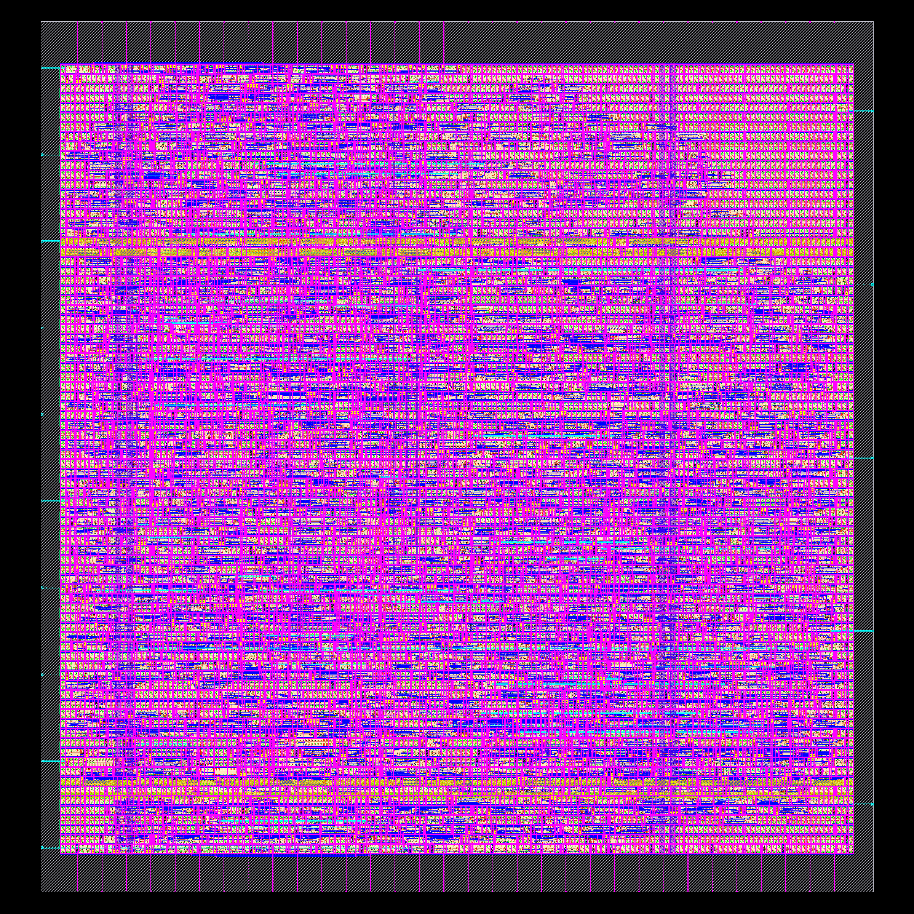
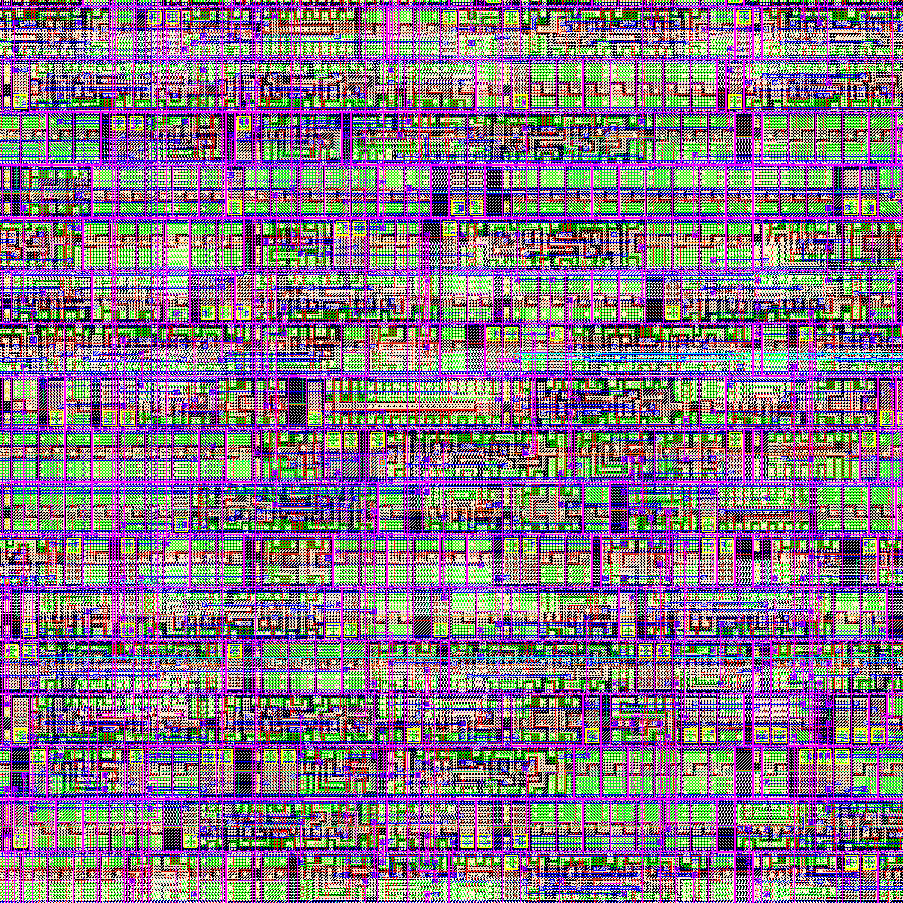

# UART RTL to GDS Flow

An APB3 UART controller taken through a full ASIC design flow: RTL design, UVM verification with SystemVerilog assertions and code and functional coverage, and RTL-to-GDSII physical design on the SkyWater **SKY130** 130 nm open PDK using OpenLane 2 (LibreLane): synthesis, floorplan, placement, CTS, routing, STA, DRC and LVS.

<p align="center">
  
</p>

---

## Highlights

| Area | Result |
|------|--------|
| UVM regression | **12 / 12 tests pass**, 0 scoreboard mismatches, 0 assertion failures |
| Functional coverage (merged) | **98.72 %** (8 covergroups) |
| Code coverage (DUT) | statement **98–100 %**, branch **96–100 %**, condition **93–100 %** |
| Toggle coverage (ports + key registers) | **114 / 114 bits (100 %)** |
| Assertions | 40+ SVA properties (APB protocol, FIFO, baud, TX/RX, IRQ, sticky flags) + 10 cover properties |
| Technology | SKY130A, `sky130_fd_sc_hd` |
| Signoff clock | **50 MHz**, timing met in **all 9 PVT/RC corners** (setup WNS +2.22 ns, hold WNS +0.11 ns) |
| Die / std-cell area | 235.3 µm × 246.0 µm (0.058 mm²) / 29,877 µm² |
| Cells | 1,398 synthesized cells (397 flip-flops); 4,149 instances after PnR |
| Power (typical) | 2.83 mW at 50 MHz |
| Physical verification | Magic DRC **0**, KLayout DRC **0**, routing DRC **0**, LVS **clean**, antenna **0** |

---

## UART features

* AMBA **APB3** slave interface, zero wait state, `PSLVERR` on unmapped addresses
* 16-deep **TX and RX FIFOs**, first-word fall-through
* Programmable baud rate: `baud = f_clk / (16 × (DIV + 1))`, **16× oversampling** receiver
* **5/6/7/8 data bits**, **none/even/odd parity**, **1 or 2 stop bits**
* RX: 2-flop synchronizer, mid-bit sampling, start-bit glitch rejection, break-safe re-arming
* Error detection: **parity error, framing error, RX overrun, TX overflow** (sticky, write-1-to-clear)
* Maskable **interrupt** (`irq`) with 6 sources
* Internal **loopback** mode

### Register map

| Offset | Name | Access | Description |
|-------:|------|:------:|-------------|
| 0x00 | TXDATA | W | Push byte into TX FIFO |
| 0x04 | RXDATA | R | Pop byte from RX FIFO (reads 0 when empty) |
| 0x08 | CTRL | RW | [0] TX_EN [1] RX_EN [2] PARITY_EN [3] PARITY_ODD [4] STOP2 [6:5] DATA_BITS [7] LOOPBACK (reset 0x60) |
| 0x0C | BAUD | RW | [15:0] divisor (reset 26 → 115200 baud @ 50 MHz) |
| 0x10 | STATUS | R | [0] TX_FULL [1] TX_EMPTY [2] RX_FULL [3] RX_EMPTY [4] TX_BUSY [5] RX_BUSY [12:8] TX_LVL [20:16] RX_LVL |
| 0x14 | IER | RW | Interrupt enables (same bit order as ISR) |
| 0x18 | ISR | R/W1C | [0] RX_AVAIL [1] TX_EMPTY [2] PARITY_ERR [3] FRAME_ERR [4] RX_OVERRUN [5] TX_OVERFLOW |

### Block diagram

```
            +-------------------------------- uart_top --------------------------------+
  APB3 ---->| uart_regs  --push--> [ TX FIFO 16x8 ] --pop--> uart_tx  ----+----------> | uart_txd
            |  (CTRL/BAUD/IER/ISR)                                      |  loopback   |
            |            <--pop--- [ RX FIFO 16x8 ] <--push-- uart_rx <-+--- mux <--- | uart_rxd
  irq <-----|  irq = |(ISR & IER)            uart_baud_gen (tick16) ---> tx / rx     |
            +--------------------------------------------------------------------------+
```

---

## Repository structure

```
uart-rtl-to-gds-flow/
├── rtl/                      Synthesizable Verilog RTL
│   ├── uart_top.v            top level
│   ├── uart_regs.v           APB3 register block + interrupt logic
│   ├── uart_tx.v             transmitter FSM
│   ├── uart_rx.v             receiver FSM (16x oversampling)
│   ├── uart_fifo.v           parameterized FWFT FIFO
│   └── uart_baud_gen.v       baud tick generator
├── verif/
│   ├── tb/                   tb_top, APB and UART interfaces
│   ├── uvm/                  UVM package: agents, scoreboard, coverage, sequences, tests
│   └── sva/                  assertion module, toggle-coverage monitor, bind file
├── sim/                      xsim regression script and file lists
├── openlane/                 OpenLane 2 config, SDC, pin order, layout render script
├── gds/                      final GDSII, LEF and DEF
├── netlist/                  gate-level netlists (nl / power-aware pnl) and SPEF (min/nom/max)
├── reports/
│   ├── verification/         regression summary, test logs, code + functional coverage (HTML)
│   └── asic/                 metrics, flow log, synthesis / DRC / LVS / antenna reports
├── docs/                     project report (PDF) and layout images
└── .github/workflows/        RTL-to-GDS flow on GitHub Actions
```

---

## Verification

### UVM environment

```
uvm_test_top
└── env (uart_env)
    ├── apb_agt  (apb_agent)    sequencer, driver (APB3 master BFM), monitor
    ├── uart_agt (uart_agent)   sequencer, driver on rxd, tx_mon (txd), rx_mon (rxd)
    ├── sb  (uart_scoreboard)   reference model: TX/RX/loopback data paths, FIFO occupancy,
    │                           sticky ISR model with W1C, register mirror, PSLVERR decode
    └── cov (uart_coverage)     8 covergroups
```

* **Scoreboard:** checks every TX frame on `txd` (data, parity, stop bits) against APB writes, every APB read of RXDATA against frames driven on `rxd`, overflow and overrun behaviour, ISR sticky bits, and CTRL/BAUD/IER read-back.
* **Assertions (`verif/sva/uart_sva.sv`):** APB protocol and PSLVERR decoding, FIFO count/flag integrity and no-push-when-full, single-cycle baud ticks, `txd` changing only on the bit-tick grid, start bit after every FIFO pop, idle-high line, RX valid/error pulse qualification, overrun/overflow/parity/framing flag setting, sticky bits cleared only by W1C, `irq == |(ISR & IER)`, loopback pin isolation, reset values.
* **Functional coverage:** frame format cross (data bits × parity × stop bits × direction), data values incl. all-zeros/all-ones/alternating per width, RX error cross, register access cross (address × R/W), baud divisor ranges, ISR bits × IER settings, FIFO levels (empty/partial/full), operating mode cross.
* **Code coverage:** xsim statement/branch/condition coverage on the RTL. The xsim toggle metric is not reported for this Verilog-2001 RTL, so a bound toggle monitor tracks 0→1 and 1→0 on all 114 port and key register bits.

### Tests

| Test | What it covers |
|------|----------------|
| `uart_smoke_test` | 8N1 basic TX and RX |
| `uart_reg_test` | reset values, R/W patterns, RO registers, PSLVERR, mode walk |
| `uart_tx_test` | 16 random frame formats / baud rates, TX bursts |
| `uart_rx_test` | 16 random formats, RX bursts with start-bit glitches |
| `uart_duplex_test` | simultaneous TX and RX |
| `uart_parity_err_test` | parity error injection, ISR flag, W1C |
| `uart_frame_err_test` | framing error (stop bit low) injection, line re-arming |
| `uart_overrun_test` | 20 frames into a 16-deep RX FIFO |
| `uart_overflow_test` | 20 writes into a 16-deep TX FIFO with TX disabled |
| `uart_loopback_test` | internal loopback with random formats |
| `uart_irq_test` | each interrupt source: set, mask and clear |
| `uart_random_test` | constrained-random mix of all scenarios |

### Results

```
TEST                     SEED   RESULT UVM_ERR  SVA_FAIL
uart_smoke_test          1      PASS   0        0
uart_reg_test            1      PASS   0        0
uart_tx_test             1      PASS   0        0
uart_rx_test             1      PASS   0        0
uart_duplex_test         1      PASS   0        0
uart_parity_err_test     1      PASS   0        0
uart_frame_err_test      1      PASS   0        0
uart_overrun_test        1      PASS   0        0
uart_overflow_test       1      PASS   0        0
uart_loopback_test       1      PASS   0        0
uart_irq_test            1      PASS   0        0
uart_random_test         1      PASS   0        0
PASSED 12 / 12
TOGGLE_COV: 114 / 114 bits toggled 0->1 and 1->0 (100.00%, cumulative)
```

| Covergroup | Merged score |
|------------|-------------:|
| cg_frame | 96.67 % |
| cg_data | 94.64 % |
| cg_rx_err | 100 % |
| cg_apb | 98.44 % |
| cg_baud | 100 % |
| cg_isr | 100 % |
| cg_status | 100 % |
| cg_mode | 100 % |
| **Total** | **98.72 %** |

| Module | Statement | Branch | Condition |
|--------|---------:|-------:|----------:|
| uart_regs | 100 % | 100 % | 100 % |
| uart_fifo (x2) | 100 % | 100 % | 92.86 % |
| uart_tx | 98.36 % | 96.00 % | 100 % |
| uart_rx | 98.59 % | 96.30 % | 100 % |
| uart_top | n/a | 100 % | 100 % |

The remaining statement/branch holes in `uart_tx` and `uart_rx` are the unreachable `default:` arms of the FSM case statements.

Full HTML reports: `reports/verification/functional_coverage_html/dashboard.html` and `reports/verification/code_coverage_html/dashboard.html`.

### Running the regression (Vivado 2024.2 xsim)

```bash
cd sim
./run_regression.sh                    # all 12 tests + coverage reports
./run_regression.sh uart_irq_test      # selected tests
SEED=7 ./run_regression.sh             # different random seed
```

---

## RTL-to-GDS (SKY130, OpenLane 2)

Flow: Yosys synthesis → floorplan and PDN → global/detailed placement → CTS → global/detailed routing → parasitic extraction (min/nom/max) → multi-corner STA → Magic and KLayout DRC → Netgen LVS → antenna check → GDSII.

| Metric | Value |
|--------|------:|
| Clock | 50 MHz (20 ns), 30 % I/O budgets |
| Setup WNS / TNS (worst of 9 corners) | **+2.22 ns** / 0 |
| Hold WNS (worst of 9 corners) | **+0.11 ns** |
| Setup WNS ss_100C_1v60 / tt_025C_1v80 / ff_n40C_1v95 | +2.34 / +5.00 / +6.03 ns |
| Clock skew (worst) | 0.28 ns |
| Die size | 235.3 × 246.0 µm |
| Std-cell area / utilization | 29,877 µm² / 59.8 % of core (incl. fill/tap) |
| Synthesized cells / flip-flops | 1,398 / 397 |
| Total power (tt) | 2.83 mW (internal 1.85, switching 0.98) |
| Routed wirelength | 59,412 µm |
| I/O pins | 81 |
| Magic DRC / KLayout DRC / route DRC | 0 / 0 / 0 |
| LVS | clean |
| Antenna violations | 0 |

At **100 MHz** the same design meets timing in the typical and fast corners (setup WNS +1.51 ns at tt_025C_1v80) and misses by 0.64 ns only in the slow corner (ss, 100 °C, 1.60 V). Signoff is therefore done at 50 MHz, the usual clock for a UART peripheral, with margin in every corner. Max-slew and max-cap warnings remain in the slow-slow corner on a few nets; typical and fast corners are clean.

<p align="center">
  
</p>

### Reproducing the flow

The flow runs on every push to `rtl/` or `openlane/` (see `.github/workflows/rtl2gds.yml`). To run it locally with Docker:

```bash
pip install librelane
librelane --dockerized openlane/config.json
```

---

## Tools

| Stage | Tool |
|-------|------|
| RTL simulation, UVM 1.2, SVA, coverage | AMD Vivado 2024.2 XSIM / XCRG |
| Synthesis | Yosys |
| Floorplan, placement, CTS, routing, STA | OpenROAD / OpenSTA (OpenLane 2 / LibreLane) |
| DRC / LVS / GDS | Magic, KLayout, Netgen |
| PDK | SkyWater SKY130A |

---

## 👨‍💻 Author
**M Kamaraju**
📬 [LinkedIn](https://www.linkedin.com/in/magupallikamaraju/)
📧 [mnithen79@gmail.com](mailto:mnithen79@gmail.com)

If you use or build on this project, please give credit by linking back to this repository.

## 📄 License
This project is licensed under the MIT License. See [LICENSE](LICENSE) for full details.
